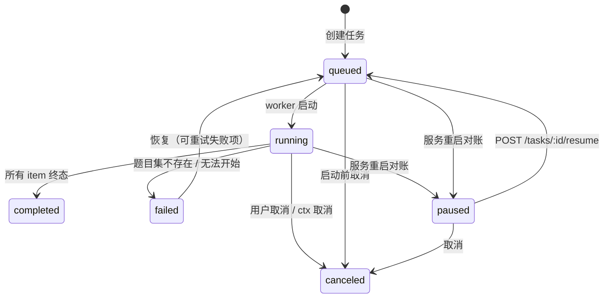
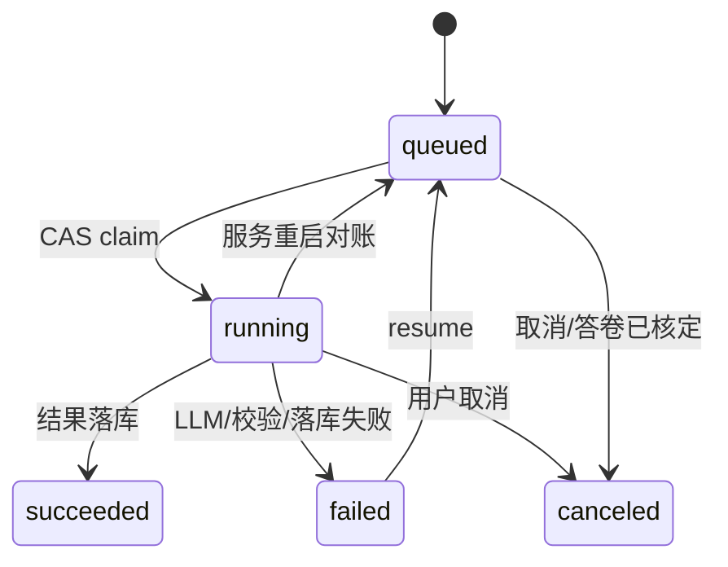
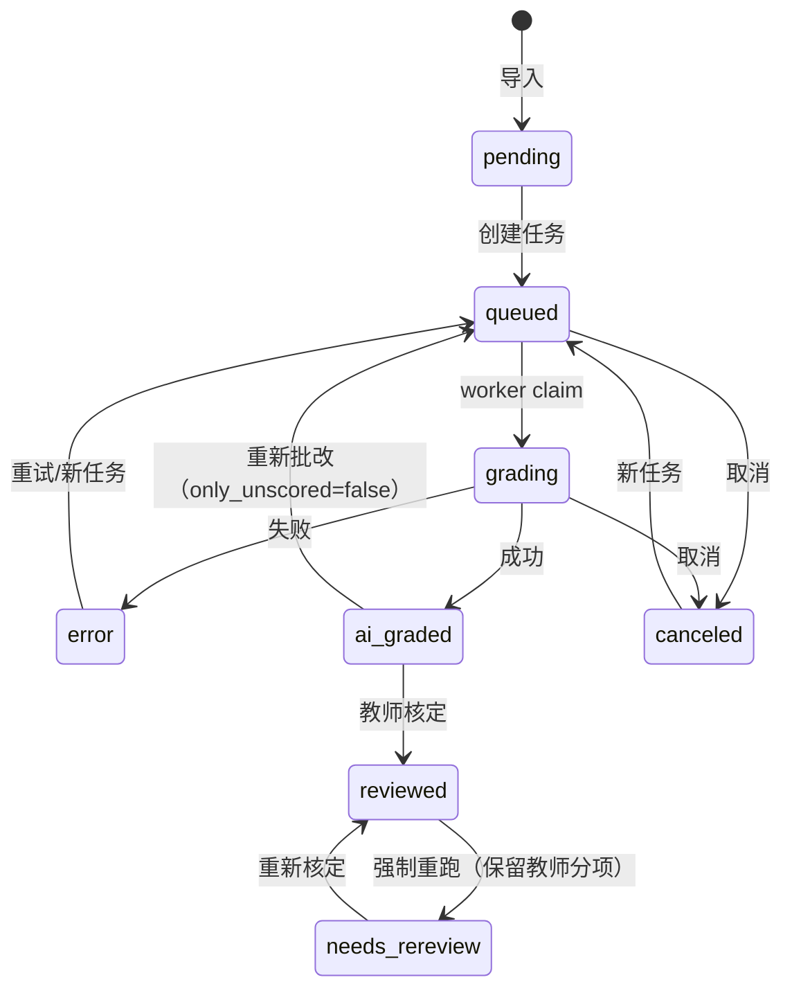

# PsychGrader 架构说明（2026-11-19）

> 本文描述当前代码（含本轮 P0/P1 修复）的真实结构。评审报告见 [`CODE_REVIEW_2026-11-19.md`](CODE_REVIEW_2026-11-19.md)，接口字段见 [`API.md`](API.md)，部署见 [`OPERATIONS.md`](OPERATIONS.md)。

## 1. 系统概览

```
┌─────────────────────────────────────────────────────────────────┐
│ Browser (React 18 + Vite + Tailwind v4)                         │
│  App.tsx        UI 状态机 / 任务轮询 / 题库                       │
│  GradeView.tsx  三栏阅卷台 / 评审 / 导入 / 导出                   │
│  api.ts         Bearer token / Blob 下载 / 任务接口               │
└───────────────┬─────────────────────────────────────────────────┘
                │ HTTP (JSON / multipart)
┌───────────────▼─────────────────────────────────────────────────┐
│ Go 1.23 + Gin                                                   │
│  main.go        CORS / 超时 / 静态 SPA / 监听地址                  │
│  handlers/api.go 鉴权 / 题集 / 导入 / 任务 / 评分 / CSV             │
│  grader/       DeepSeek 请求、JSON 校验、确定性规则审计、离线启发式   │
│  pdfparse/     pdftotext / 纯 Go PDF 解析、分页、分句                │
│  ced/          AP CED 概念表、同义词归一、禁用词匹配                  │
│  db/           SQLite（WAL）、迁移、任务表、状态机、启动对账          │
└───────────────┬─────────────────────────────────────────────────┘
                │
        ┌───────▼────────┐        ┌──────────────────────┐
        │ SQLite          │        │ DeepSeek Chat API     │
        │ data/*.db       │        │ 可配置 base_url/模型   │
        └────────────────┘        └──────────────────────┘
```

- 部署形态：单二进制 + 同目录 `static`（Docker/本地构建产物）或外部 `STATIC_DIR`，SQLite 文件持久化；Docker 运行时非 root（UID 1000）。
- 单教师/单口令模型；没有多租户、班级/花名册、学生登录。

## 2. 目录与职责

| 路径 | 职责 |
|---|---|
| `backend/main.go` | 进程入口；`HOST`/`PORT`、`http.Server` 超时、CORS 白名单、SPA fallback、启动日志 |
| `backend/internal/handlers/api.go` | 所有 HTTP 路由与鉴权；任务创建/worker/取消/恢复；CSV；上传限制 |
| `backend/internal/db/db.go` | 连接池（单连接）、schema、题集/答卷 CRUD、任务表、状态 CAS、启动对账、教师结果合并 |
| `backend/internal/db/seed.go` | 首次空库种子；`settings.seeded` 一次性标记，删库后重启不会复活 |
| `backend/internal/grader/deepseek.go` | LLM 请求/重试/超时；JSON 解析校验；`EnforceOfficialRules`；离线 EBQ 启发式 |
| `backend/internal/grader/rubric_prompt.go` | AAQ/EBQ prompt、JSON schema、学生文本 `<student_response>` 定界 |
| `backend/internal/pdfparse/parser.go` | PDF 页文本提取、页眉识别、分页切分、句子切分；`pdftotext` 60s 超时、80 页上限 |
| `backend/internal/ced/glossary.go` | AP CED 概念、alias、禁用词匹配 |
| `backend/internal/models/models.go` | API 模型：ProblemSet / Submission / GradingResult / GradingTask / TaskItem |
| `frontend/src/App.tsx` | reducer 状态机、任务轮询、题集打开、草稿 seed/身份校验 |
| `frontend/src/GradeView.tsx` | 三栏 UI、批量进度条、评审/重跑/导入/导出、任务操作 |
| `frontend/src/api.ts` | fetch 封装、401 全局处理、任务接口、Blob CSV 下载 |
| `frontend/src/components/*` | **目前为未引用的旧实现（死代码）**，实际使用的是 `GradeView.tsx` 内联版本；删除前请确认无外部引用 |

## 3. 数据模型

```sql
problem_sets(id, title, question_type, prompt_text, sources_json,
             ineligible_concepts_json, scoring_notes, created_at, updated_at)

submissions(id, problem_set_id, student_name, student_code, page_range,
            raw_text, status, ai_score, final_score, result_json,
            teacher_notes, error_msg, created_at, updated_at)

grading_tasks(id, problem_set_id, status, total, succeeded, failed, canceled,
              source, error_summary, created_at, started_at, finished_at)

grading_task_items(id, task_id, submission_id, status, attempt, error_msg,
                   started_at, finished_at,
                   UNIQUE(task_id, submission_id))
```

- `result_json` 保存完整 `GradingResult`（句子、annotation、rubric parts、总评、模型信息、reasoning trace）。
- 教师逐项分 `teacher_score` / `teacher_comment` 也存在 `result_json.rubric_parts` 中；没有单独的教师版本表。
- `final_score` 是教师核定总分；`ai_score` 是 AI 总分。
- 没有 `revision` 列；并发控制依赖任务 item 的原子 claim + 状态保护（见 §5）。

## 4. 状态机

### 4.1 批改任务（GradingTask）



- 终态：`completed` / `failed` / `canceled`；`completed` 不代表没有失败，看 `failed` 计数。
- `paused` 由启动对账写入，**不会自动续跑**，避免无感扣费。
- 取消是用户意图，已完成的评分保留；正在飞行的 LLM 请求不保证能停止上游计费，UI 会明确提示。

### 4.2 任务项（TaskItem）



- `ClaimTaskItem` 是 `UPDATE ... WHERE status='queued'` 的条件更新；并发 worker 只有一个能拿到。
- `ClaimSubmission` 是第二个 CAS：`status IN ('queued','pending','error','canceled')` 才能进入 `grading`。
- 任一 CAS 失败 → item `canceled`，不会重复调用 LLM。

### 4.3 答卷（Submission）



- **`reviewed` 保护**：`SaveGradingResult(id,res,force=false)` 读取旧状态，若 `reviewed` 返回 `ErrReviewed`；批量任务把该项记为 `canceled`（跳过），不会覆盖。
- **强制重跑**：`POST /submissions/:id/grade` 带 `{"force":true}`；新 AI 结果合并旧 `teacher_score/teacher_comment`，状态置 `needs_rereview`，`final_score` 保留。
- `needs_rereview` 的卷默认被批量任务跳过；教师需重新核定。

## 5. 并发与恢复

### 5.1 并发控制

- 每个题集最多一个活跃任务（`queued/running/paused`）；重复 `grade-all` 返回同一任务（`reused=true`）。
- 多个题集可以同时有任务；全局 `Server.gradeSem` 容量 16，任务内 worker 数 = 设置中的 `concurrency`（1–16）。因此跨任务总并发 ≤16。
- 每个任务内 worker 从 `grading_task_items` 的 `queued` 队列取活；`ClaimTaskItem` + `ClaimSubmission` 双 CAS。
- SQLite `SetMaxOpenConns(1)` + WAL + `busy_timeout=5000`；LLM 调用期间不持有事务/连接。

### 5.2 启动对账

`db.Open` 调用 `ReconcileInterruptedTasks`：

1. `grading_task_items` 的 `running` → `queued`；
2. `grading_tasks` 的 `queued/running` → `paused`，`error_summary='服务重启中断，可在任务中心继续'`；
3. `submissions` 的 `grading` → `queued`。

前端打开题集时 `GET /problem-sets/:id/active-task` 会拿到 `paused` 任务，显示“继续批改/取消”。

### 5.3 失败与重试

- LLM 请求：429/5xx/网络错误最多 3 次指数退避（1s/2s），`context` 取消立即停止；单请求 150s，任务项/单份批改上下文 180s。
- LLM 输出：缺任一 rubric part → 整份失败（不再静默 0 分）；`ai_score` 支持 `1`/`1.0`/`"1"`；`finish_reason=length` 报错；`exact_quote` 不在原句 → `unverified_quote` flag。
- 失败项在任务里可“继续批改”（resume 会把 `failed` 项重新排队）；单份可点“重试”。

## 6. 前端状态与进度

`App.tsx` reducer 的关键不变量：

- `activeSubId` 与 `draftParts/draftNotes` 必须指向同一份答卷；`draftDirty` 表示有未核定改动。
- `OPEN_PSET` 会 seed 第一份的草稿；`REFRESH_SUBS` **不会**重置选中，只在草稿干净时同步最新 AI 结果。
- `onSubsRefresh()` 返回最新 `Submission[]`；`核定并下一份` 先 await 刷新，再按 id 选下一份，不再被 `OPEN_PSET` 的 `subs[0]` 覆盖。
- 切换学生/返回题库时若有 `draftDirty`，弹确认。
- 批量进度由 `batch: GradingTask | null` 驱动；轮询 `GET /tasks/:id`，每 2 tick 拉一次完整列表，终态后停止。轮询条件不再依赖 `subs.some(status==='grading')`。
- 顶部进度条显示 `成功/失败/跳过`、`current[]` 当前学生、取消/继续/关闭。
- 单份“重跑”按 `gradingIds` 独立禁用，不再用一个全局 `grading` 布尔；`reviewed/needs_rereview` 重跑需确认并传 `force`。

## 7. 安全模型

| 项 | 当前实现 |
|---|---|
| 登录 | 单口令 `ADMIN_PASSCODE`；失败限流 5 次/分钟/IP；常量时间比较 |
| Token | HMAC(secret, `exp:passcode`)，7 天过期；`Authorization` header only；无 query token |
| Secret | `APP_SECRET` 环境变量；为空则每进程随机生成（重启后旧 token 失效） |
| CORS | 仅 `localhost:5173` / `127.0.0.1:5173` + `ALLOWED_ORIGINS`；无通配 |
| 监听 | 默认 `127.0.0.1`；非 loopback 且 `ADMIN_PASSCODE` 为空时拒绝启动；Docker 内 `HOST=0.0.0.0`，compose 只发布 `127.0.0.1` |
| CSRF/写接口 | 非 GET 要求 `application/json`（PDF 上传为 multipart）；跨站 Origin 直接 403；`SetTrustedProxies(nil)` 防 X-Forwarded-For 伪造 |
| API Base URL | 默认只允许 `api.deepseek.com`、localhost、`ALLOWED_API_HOSTS` / `ALLOWED_API_BASE_URLS` |
| 测试连接 | 必须显式填 API Key，不再回退已保存 Key |
| 上传 | 25MB `MaxBytesReader`、80 页、`pdftotext` 60s 超时 |
| CSV | 公式注入转义 `= + - @ \t`；`mime.FormatMediaType` 中文文件名；`Authorization` header 下载 |
| 容器 | 非 root UID 1000、`cap_drop: ALL`、`no-new-privileges`、healthcheck |

未覆盖/后续项：单口令多教师无隔离、无审计表、无软删除、API Key 仍明文存 SQLite、无 token 撤销列表/登出接口。

## 8. 设计取舍与已知限制

1. **没有独立 `batches` UI 抽屉**：任务条在阅卷页顶部；题库页只显示活跃任务计数。跨题集任务中心是下一步。
2. **没有真正的“暂停”按钮**：`paused` 只由服务重启产生；运行中只能取消。
3. **取消不保证停止上游计费**：已经在飞的 HTTP 请求可能已完成；UI 明示。
4. **CSV 仍导出所有状态**（pending/error 等），但每行有 `Status`；后续可加导出预检与 `Score Source` 列。
5. **教师分项与 AI 结果共用 `result_json`**：已通过“强制重跑合并 + needs_rereview”保护，但长期应拆 `teacher_parts_json` + revision。
6. **死代码**：`frontend/src/components/*` 仍未接入；实际 UI 在 `GradeView.tsx`。清理前先补快照/视觉回归。
7. **单连接 SQLite**：适合单教师/小班；多教师并发前应评估 Postgres 或至少 WAL 读连接池。
